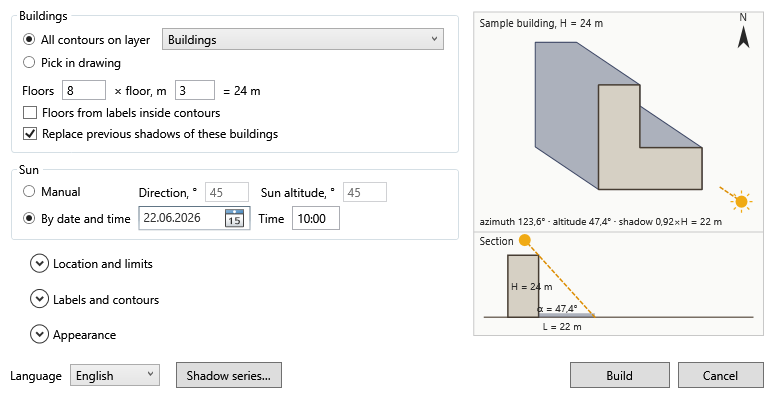
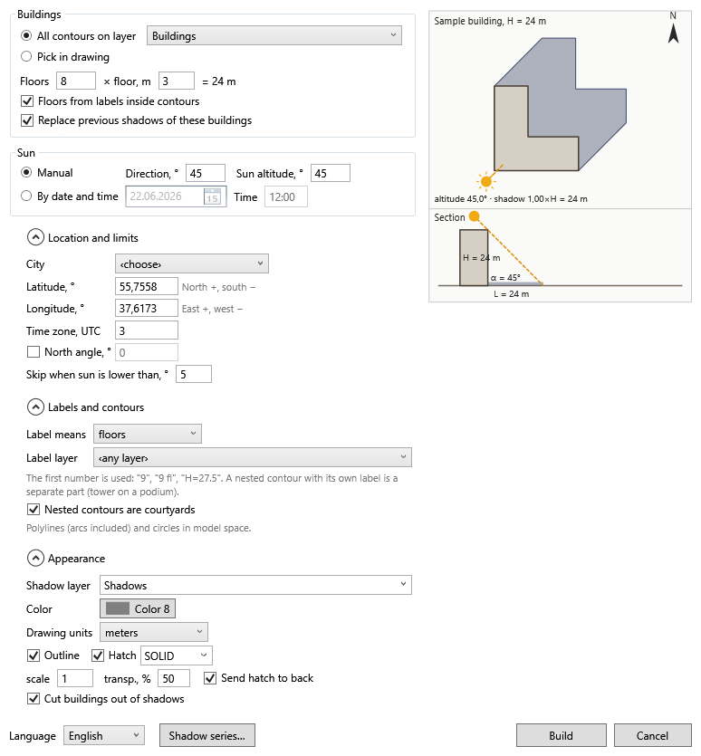
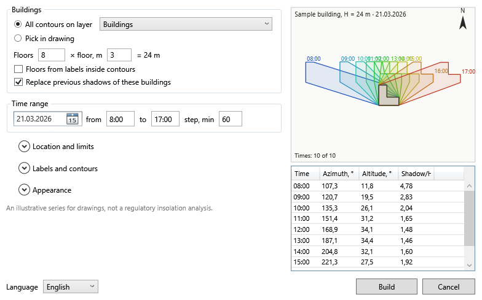

# DwgShadow — building shadows for AutoCAD

[Русская версия](README.ru.md)

An AutoCAD .NET plug-in that draws building shadows from footprint contours, for site plans and urban design drawings. It replaces an old Python/COM script (kept in `old/` for reference).



## Features

- **Sun direction and altitude.** Set them manually, or calculate them from latitude, longitude, date and time (NOAA solar position algorithm, works offline).
- **Compact dialog with a live preview.** A sample building is shown in plan and section. Less frequent options sit in collapsible sections.
- **Building source.** Use every closed contour on a layer, or pick contours in the drawing.
- **Building height.** One height for all buildings, or the floor count or height taken from a TEXT/MTEXT label inside each contour ("9", "9 fl", "H=27.5").
- **Courtyards and building parts.** A contour nested in a building is a courtyard. If the nested contour has its own label, it is a separate part instead, such as a tower on a podium.
- **Arcs.** Polylines with arc segments and circles are supported.
- **Safe re-building.** Every shadow object remembers which buildings it came from.
  - Whole layer: all objects on the shadow layer are replaced.
  - Picked buildings: only their shadows are replaced. Shadows merged with them, or overlapping their new shadows, are rebuilt together, so nothing is lost or duplicated.
- **Low-sun safety limit.** No shadow is built when the sun is lower than the limit, so you never get absurdly long shadows.
- **Shadow series for a day.** A separate dialog builds one layer per time, with time labels and a combined shadow zone.
- **Russian and English UI.** The language is detected automatically or chosen in the dialog.
- **Remembered settings.** All settings, including which sections are expanded, are kept between sessions.
- **Single undo and no crashes.** One undo (`Ctrl+Z`) reverts a whole build. Errors are reported on the command line and logged to `%APPDATA%\DwgShadow\log.txt`, so they never take AutoCAD down.





## Commands

| Command | Action |
|---|---|
| `SHD` | Shadow dialog |
| `SHDSERIES` | Shadow series dialog |
| `-SHD`, `-SHDSERIES` | Same without a dialog, using the last saved settings (scripts, quick rebuilds) |

## Installation

Requirements: AutoCAD 2021–2024 (including verticals such as AutoCAD Architecture). Building from source also needs the .NET SDK 8 or later.

```bash
powershell -ExecutionPolicy Bypass -File scripts\install.ps1
```

The script builds the plug-in and copies `DwgShadow.bundle` to `%APPDATA%\Autodesk\ApplicationPlugins`. AutoCAD then loads the plug-in automatically on every start. If AutoCAD was running during installation, restart it.

To uninstall:

```bash
powershell -ExecutionPolicy Bypass -File scripts\uninstall.ps1
```

## How it works

The shadow of a prism with footprint *P* and height *H* is *P* swept along the shadow vector of length `L = H / tan(sun altitude)` (a Minkowski sum). Boolean operations (merging shadows, cutting out buildings, courtyards) use [Clipper2](https://github.com/AngusJohnson/Clipper2), which is robust to touching edges and degenerate contours.

North is the drawing Y axis by default. If the plan is rotated, enable **North angle** and enter the rotation of the north arrow in degrees counter-clockwise. Time is local standard time; Moscow, for example, is UTC+3.

Each drawn object has an extension-dictionary record (`DWGSHADOW`) with soft pointers to its source contours. The pointers survive copy/paste and WBLOCK.

The shadow series is an illustration for drawings, not a regulatory insolation analysis.

## Other AutoCAD versions

- **2021–2024 (R24.x):** this build works as is; all of them run on .NET Framework 4.8.
- **2025 and later:** these run on .NET 8. Add a second target (`net8.0-windows` with the `AutoCAD.NET` 25.x package) and another `ComponentEntry` in `bundle/PackageContents.xml`. Little or no code change is expected.

## Project layout

```
src/DwgShadow/
  Core/      sun position, shadow geometry, building grouping, settings, localization (no AutoCAD dependency)
  Cad/       reading contours and labels, writing and tagging results, build scenario
  UI/        WPF dialogs and preview
  Plugin.cs  commands
bundle/      autoload package manifest
scripts/     build, install, uninstall
tests/DwgShadow.CoreTests   checks of the calculation core (dotnet run)
tests/UiSnapshot            renders the dialogs to PNG without AutoCAD
old/         the original Python script
```

Run the core checks:

```bash
dotnet run --project tests/DwgShadow.CoreTests
```

## License

[MIT](LICENSE). Uses [Clipper2](https://github.com/AngusJohnson/Clipper2) (Boost Software License 1.0).
