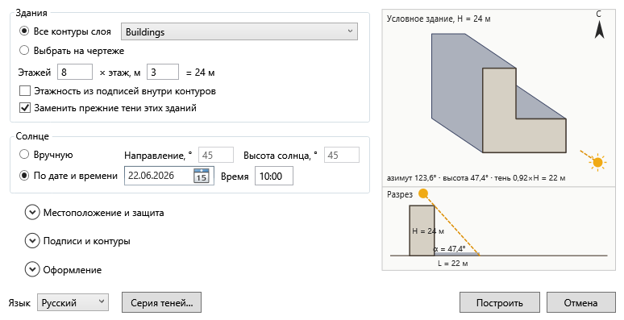
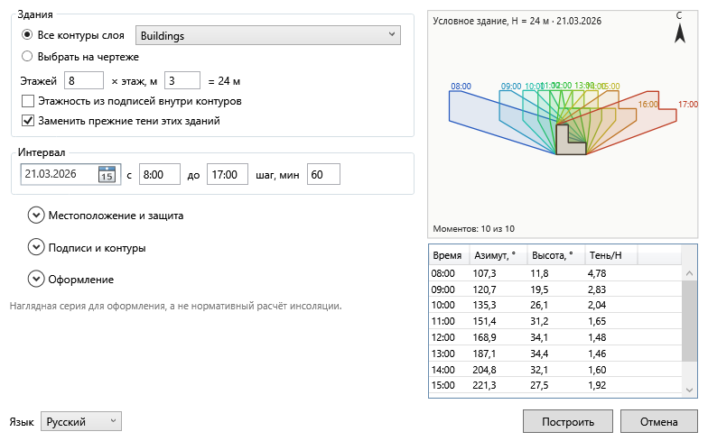

# DwgShadow — тени зданий для AutoCAD

[English version](README.md)

Плагин для AutoCAD (.NET) строит тени зданий по их контурам в плане, чтобы оформлять чертежи застройки территории. Это новая версия старого скрипта на Python (он лежит в `old/`).



## Возможности

- **Направление и высота солнца.** Задаются вручную или рассчитываются по широте, долготе, дате и времени (алгоритм NOAA, интернет не нужен).
- **Компактное окно с превью.** Условное здание показано в плане и в разрезе. Редкие настройки спрятаны в разворачивающихся разделах.
- **Какие здания строить.** Все замкнутые контуры слоя или выбранные на чертеже.
- **Высота зданий.** Одна для всех или из подписи TEXT/MTEXT внутри контура: «9», «9 эт.», «H=27,5».
- **Дворы и части зданий.** Контур внутри здания считается двором. Если у вложенного контура своя подпись, это отдельная часть здания, например башня на стилобате.
- **Дуги.** Поддерживаются полилинии с дугами и окружности.
- **Аккуратное перестроение.** Каждый объект тени помнит, от каких зданий он построен.
  - Слой целиком: все объекты на слое теней заменяются.
  - Выбранные здания: заменяются только их тени. Тени, слитые с ними или пересекающиеся с новыми, перестраиваются вместе с ними, так что ничего не теряется и не дублируется.
- **Защита от низкого солнца.** Если солнце ниже порога, тень не строится и не уходит на сотни метров.
- **Серия теней за день.** Отдельное окно: каждый момент на своём слое, подписи времени, общая зона затенения.
- **Русский и английский интерфейс.** Язык определяется автоматически или выбирается в окне.
- **Настройки запоминаются.** Сохраняется всё, включая то, какие разделы развёрнуты.
- **Одна отмена и без падений.** Всё построение отменяется одним `Ctrl+Z`. Ошибка не роняет AutoCAD: сообщение выводится в командную строку, подробности пишутся в журнал `%APPDATA%\DwgShadow\log.txt`.



## Команды

| Команда | Что делает |
|---|---|
| `SHD` | Окно построения тени |
| `SHDSERIES` | Окно серии теней |
| `-SHD`, `-SHDSERIES` | То же без окна, с последними сохранёнными параметрами |

## Установка

Нужен AutoCAD 2021–2024 (в том числе Architecture). Для сборки из исходников — .NET SDK 8 или новее.

```bash
powershell -ExecutionPolicy Bypass -File scripts\install.ps1
```

Скрипт собирает плагин и копирует пакет `DwgShadow.bundle` в `%APPDATA%\Autodesk\ApplicationPlugins`. После этого AutoCAD загружает плагин сам при каждом запуске. Если AutoCAD был открыт во время установки, перезапустите его.

Удаление:

```bash
powershell -ExecutionPolicy Bypass -File scripts\uninstall.ps1
```

## Как считается тень

Тень здания-призмы — это контур основания, «протянутый» на вектор тени длиной `L = H / tg(высоты солнца)`. Булевы операции выполняет библиотека [Clipper2](https://github.com/AngusJohnson/Clipper2).

Север по умолчанию — ось Y чертежа. Если план повёрнут, включите «Угол севера» и укажите поворот стрелки севера в градусах против часовой стрелки. Время задаётся поясное, например для Москвы UTC+3.

Серия теней — это наглядный материал для оформления, а не нормативный расчёт инсоляции.
